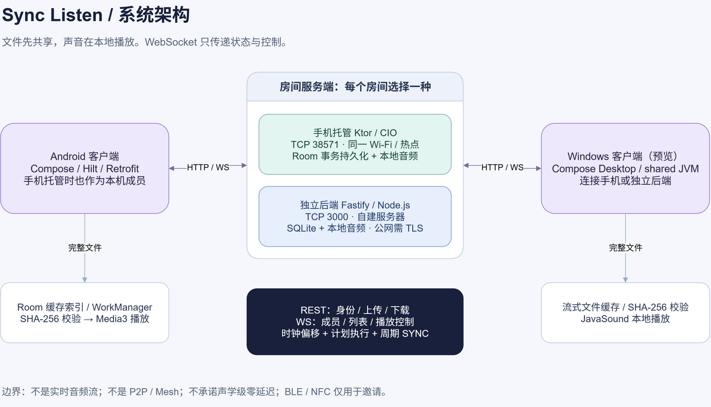

# 架构与演进

更新：2026-09-16，适用于 v0.3.0。可编辑图源：[architecture.drawio](images/architecture.drawio)。

## 真实依赖边界

| 模块 | 职责 | 不负责什么 |
|---|---|---|
| android-app | Compose/Hilt 页面；Retrofit/OkHttp；Room 缓存；WorkManager；Media3；Ktor 手机托管与恢复 | 不依赖 root shared 模块，不捕获其他音乐 App 的声音 |
| backend | Fastify REST、WebSocket、SQLite、流式文件存储与清理工具 | 非云服务，不内置账号、TLS、全局配额 |
| shared | Desktop 使用的 DTO、设置、身份、网络、同步策略、内存 Ktor 服务端 | 其中的服务端不具备 Android 的 Room 恢复能力 |
| desktop | Compose Desktop、Java Sound 播放、下载校验与桌面会话生命周期 | 当前界面不提供本机托管入口 |
| protocol | 按服务端 origin 隔离的设备凭据算法 | 不包含平台存储或网络实现 |

根 Gradle 构建 shared/desktop；android-app 是独立 Gradle 构建。protocol 的 Kotlin 源目录同时编译进两侧。不要把“目录叫 shared”误认为 Android 已经使用它。

## 数据流

### 云端音乐

Node 后端的 `src/cloud/music.ts` 与 `protocol/src/main/kotlin/com/synclisten/cloud` 提供网易、QQ、酷狗、酷我的搜索和地址解析。Node 与 Ktor 托管服务提供需要房间成员凭据的搜索和解析接口；Android 和桌面房间界面提供搜索、解析、入队、在线播放和主动下载。房间保存来源曲目标识、所选音质和可获得的解析元数据，客户端各自重新解析及缓冲，不持久化临时播放地址。房间包含云曲目时拒绝旧协议客户端加入，入队时也检查在线成员的协议版本。解析元数据和搜索元数据分别保留；QQ 直接解析校验歌曲 MID 和媒体文件名，但不能证明音频身份。时长一致也不证明是同一录音。

搜索界面按来源切换，展示曲名、歌手、专辑和时长，并可显示网易、QQ 和酷我的专辑封面；封面仅从允许的图片域名读取。关闭搜索面板后保留当前选择，房间页显示下载状态。解析结果的标题或歌手与搜索信息可检测地不同时，界面提示用户核对；一致也不能证明录音版本一致。队列和播放栏可打开歌曲详情，展示来源、音质及解析版本。网易和酷狗曲目支持按本机播放位置高亮并滚动时间标记歌词，可切换自动跟随与手动浏览；具有控制权限的成员可点击歌词定位。酷狗候选需核对歌名和歌手。无时间标记的文本按原文显示。其他来源及本地文件尚未接入歌词，界面明确提示不可用。

网易、酷狗和酷我使用第三方明文 HTTP 聚合服务，响应解密不提供服务端认证或传输完整性；服务可用性、音质与授权状态均不由本项目保证。QQ 匿名直连接口可能无可用地址，不自动回退到可能返回不同版本的聚合结果。网易多音质请求失败或结果为空时才尝试标准音质接口；候选排序按服务顺序或已知码率，未知码率排在已知码率之后。外部服务可能返回试听片段；调用方须检查结果并取得相应使用权。

`CloudDownloader` 接收经调用方确认的解析结果，按候选顺序下载；候选不可用时可重新解析一次，并要求刷新后的来源、曲目和媒体标识相同。下载先写临时文件，检查响应长度和音频文件头，计算并回读核对 SHA-256 后提交到不存在的目标文件；失败或取消时移除临时文件。Android 通过系统文件选择器保存，并回读核对；Windows 使用文件选择器。SHA-256 用于记录下载文件的指纹，并非来自服务端的可信完整性校验值。文件头不能证明曲目身份或音频可完整解码。

1. DataStore（Android）或原子 JSON 设置文件（Desktop）保存 userId、昵称和设备随机 secret。
2. IdentityManager 按规范化服务端 origin 派生凭据。创建/加入 REST 请求绑定该设备身份。
3. RoomRepository 取得房间、成员、joinToken。RoomWebSocket 在握手时携带设备凭据及邀请令牌。
4. 服务端 ROOM_JOINED 提供完整权威快照；后续事件更新成员、列表与播放状态。
5. 上传先读取实际字节、计算 SHA-256，服务端再流式校验；相同 hash 复用物理文件，曲目仍有独立 ID 和顺序。
6. 本地曲目下载到临时文件，核对长度和 SHA-256 后才提交缓存索引；云曲目则由客户端分别解析和缓冲。
7. 房主或管理员发送控制命令，服务端决定执行时间；客户端播放并根据 SYNC 修正。

房主手机也走同一 REST/WebSocket 路径，只是地址为 127.0.0.1:38571。其他设备使用其可达 LAN 地址。Node 后端是可选替代，不是手机模式的依赖。

## 一致性与安全

- 房间邀请和成员身份分离。知晓房间码不允许冒充已存在的 Host；重新加入已有 userId 必须验证原凭据。
- 服务端对播放、删歌、重排、改角色做权限检查；UI 按最新成员角色更新。
- 服务端在锁/事务内分配列表顺序。Node 重排先使用临时负索引，避免 SQLite 唯一约束冲突。
- Android HostRoomStore 的写操作在 Room 事务内提交；失败时还原内存镜像，避免内存和磁盘出现两个版本。
- Android schema v2 持久化成员凭据摘要；旧版无凭据房间无法安全恢复，升级时使旧恢复标记失效。
- 下载和上传有单文件上限；没有用户级总配额。HTTP/WS 明文，仅适用于可信网络。
- 多个 WebSocket 同时代表一个用户时，只有最后一个连接关闭才标记离线。

## 生命周期与恢复

HostServerService 为前台托管服务，IO 启停串行化。划掉任务不等于显式关闭房间；但系统或用户强制停止仍可能中断服务。

异常停止后，下次主动打开 App 可恢复原房间、成员、曲目和持久化播放状态，恢复后统一暂停。恢复点来自最近一次持久化命令，不保证精确到被杀进程前一刻；不支持主机迁移。显式结束房间会移除恢复标记。

客户端会话作用域负责 WebSocket、时钟刷新和缓存任务的订阅。离开房间或关闭桌面窗口时取消会话，不保留旧房间事件。401/403/404/410 属于终止性错误，不无限重连。普通断网按退避策略重连并获取新快照。

## 同步策略

用低 RTT 的 /api/time 样本估算 serverOffsetMs。PLAY/SEEK/NEXT 带未来 executeAtServerTimeMs，服务端在执行点之前不广播抢先推进的 SYNC。

Android 在小偏差时使用轻微变速，大偏差 seek。Desktop 当前不支持可靠实时变速，使用有界 seek 修正，不伪装成已经变速。缓存未就绪时保留待处理同步状态，校验完成后重试准备，避免永久停在等待缓存。

云曲目使用准备代次：在线成员分别校时、解析所选来源和音质并缓冲后报告就绪；全部就绪后服务端安排未来播放时间。失败或超时的成员显示为等待，房主可以选择继续；断线成员不阻塞当前在线成员。地址失效时客户端重新解析一次，重新解析仍要求相同来源、媒体标识、所选音质及可核对的解析元数据。准备代次只存在于运行中的服务端，恢复房间后暂停并重新准备。就绪机制不能消除网络波动、解码和声卡输出的差异。

同步指标测量的是软件时间和播放器位置，不包含扬声器、蓝牙或声卡输出延迟。

## 演进顺序

1. 稳定性：成员后台播放的 MediaSession/前台服务；磁盘不足与下载队列失败恢复；定期恢复检查点；真机与长时测试。
2. 易用性：成员就绪门槛、可理解的错误与重试、网络变更后的重新邀请、桌面音频兼容矩阵。
3. 公共核心：先用协议合同测试约束 Node / 两个 Ktor 实现，再迁移纯 DTO、校验和同步算法。平台 IO、数据库与服务保持适配器边界。
4. UI：在行为稳定之后统一导航和状态，补可访问性、字号与小屏测试，整理主题组件。避免一次性移动所有文件而失去可回归性。
